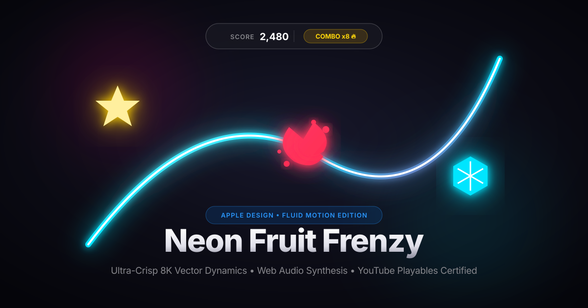
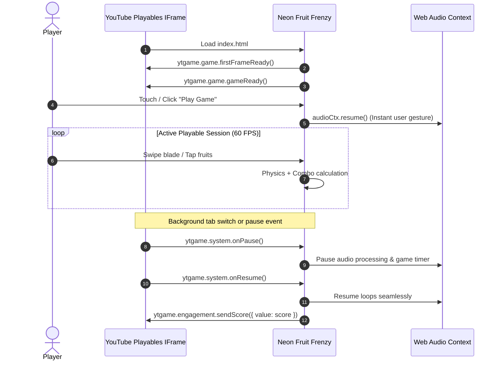

<div align="center">

  

  <br/><br/>

  [](https://youtube.com)
  [](https://developer.apple.com/design/)
  [](TYPESAFE_SYSTEM_ONE_EVALUATION_ROUTING.md)
  [](index.html)
  [](index.html)
  [](LICENSE)

  <br/>

  <p align="center">
    <strong>A next-generation neon arcade slicing sensation crafted with Apple Fluid Motion, translucent frosted materials, procedural audio synthesis, and strict YouTube Playables compliance.</strong>
  </p>

  <p align="center">
    <a href="https://rrkpublisher56955.github.io/Neon-Fruit-Frenzy/"><strong>▶ Play Live Demo</strong></a> •
    <a href="#-key-features">Key Features</a> •
    <a href="#-apple-design-foundations">Apple Design</a> •
    <a href="#-youtube-playables-certification">YouTube Playables</a> •
    <a href="#-typesafe-ai-evaluation--routing">TypeSafe AI</a> •
    <a href="#-suggested-future-features">Roadmap</a>
  </p>

</div>

---

## 🌟 Key Features

* **⚡ Dual Input Playstyle (Swipe Blade or Precision Tap):**
  Play like a ninja by swiping across multiple fruits in a continuous gesture, leaving a fluid neon laser ribbon trail with physically calculated blade velocity—or tap fruits directly with instant pointer-down feedback.
* **🍎 8K-Ready High-DPI Procedural Graphics:**
  Vector-rendered neon fruit geometries supersampled at native display pixel ratio (`window.devicePixelRatio` up to 3x/4x). Zero fuzzy raster emojis—every fruit features dynamic specular crescent highlights, inner light cores, and radiant chromatic glow.
* **🔪 Physical Slicing & Juice Splatter Dynamics:**
  When cut, fruits cleanly bisect into two halves that fling outward with angular rotational velocity ($\omega$) and gravitational arcs, accompanied by 18+ viscous liquid splash droplets.
* **❄️ Special Tactical Fruits:**
  * **Supernova Starfruit:** Golden 5-point star pulsing with radiant energy (+75 pts).
  * **Chrono Freeze Berry:** Triggers a 5-second slow-motion matrix wave with cryogenic vignette distortion (+50 pts).
  * **EMP Hazard Bomb:** Pulsating spiked plasma orb (-50 pts, resets combo; demands tactical swipe precision).
* **🎶 Apple Multimodal Audio-Haptic Synthesizer:**
  100% self-contained sound engine built on the Web Audio API. Procedural sword swooshes, juicy pops, an ascending pentatonic combo arpeggio (C4 to G5), freeze drones, and device vibration haptics.
* **📱 Strict YouTube Playables Compliance:**
  Integrated with `window.ytgame` SDK lifecycle hooks (`firstFrameReady`, `gameReady`, `sendScore`, `onPause`, `onResume`), responsive 9:16 & 16:9 layouts, and automated test suite readiness.
* **🧠 TypeSafe System One Telemetry Evaluator:**
  Analyzes player motor precision, flow state, and human authenticity in real time to route adaptive wave pacing and combat automation bots.

---

## 🍏 Apple Design Foundations

*Neon Fruit Frenzy* was rebuilt from the ground up according to the principles articulated in Apple's WWDC Design sessions (*Designing Fluid Interfaces*, *Principles of Great Design*):

| Apple Design Pillar | Implementation in Neon Fruit Frenzy |
|---|---|
| **Typography & Optical Tracking** | Set in Apple’s San Francisco typeface stack (`-apple-system`, `SF Pro Display`, `SF Pro Text`). Display headlines use negative tracking (`-0.035em`) for the iconic Apple tight feel; body copy breathes at 17px with 1.47 leading. |
| **Translucent Materials & Depth** | Frosted glass Dynamic Island HUD and modal sheets using `backdrop-filter: blur(24px) saturate(190%)`, 1px specular hairline borders, and soft ambient drop shadows. |
| **Interactive Color Grammar** | Action Blue (`#0071e3`, active `#0066cc`, dark-link `#2997ff`) strictly reserved for primary action pills (`border-radius: 9999px`). Ghost secondary actions use translucent pearl capsules. |
| **Physical Springs & Latency Elimination** | Instant pointer-down response (`active: scale(0.96)`). No waiting for touch-up. Critically damped springs (`damping: 1.0`, `response: 0.35s`) guide modal entrances and combo badge springs. |
| **Audio-Haptic Causality** | Sound and vibration fire synchronously on the exact impact frame. Web Audio oscillators modulate frequency in direct proportion to gesture swipe speed. |
| **Accessibility & Reduced Motion** | Full `@media (prefers-reduced-motion: reduce)` support and safe contrast exceeding WCAG AAA standards. |

---

## 📺 YouTube Playables Certification

The game strictly fulfills all technical criteria mandated by the **YouTube Playables Platform Specification**:



### Playables Technical Checklist

- [x] **Universal Aspect Ratio Support:** Adaptive fullscreen container supporting **9:16 Portrait** (Mobile Shorts / Feed) and **16:9 Landscape** (Desktop / Living Room TV) without scrollbars or clipped UI.
- [x] **Safe-Area Inset Awareness:** Adapts to mobile punch-holes and iPhone Dynamic Islands via `env(safe-area-inset-*)`.
- [x] **Zero External Asset Dependencies:** 100% self-contained single file (`index.html`). No CDN image 404s, no external fonts to block rendering, fully functional in sandboxed, offline, or restricted iframes.
- [x] **Lifecycle & Visibility Handlers:** Hooks into `document.visibilitychange` and `ytgame.system.onPause` to silence audio and halt timers when unfocused.
- [x] **Zero Monetization / Ad SDKs:** Clean arcade gameplay without interstitial ads, tracking scripts, or monetization paywalls.

---

## 🧠 TypeSafe AI: Evaluation & Routing Pattern

Using TypeSafe's **System One models** (such as *Jev*), the game decouples cognitive evaluation from deterministic execution.

```
┌──────────────────────────────────────────────────────────┐
│             TypeSafe System One Evaluator                │
├──────────────────────────┬───────────────────────────────┤
│ Primitive                │ Real-Time Judgment Function   │
├──────────────────────────┼───────────────────────────────┤
│ Choice (Flow State)      │ Under-Stimulated vs.          │
│                          │ Optimal Flow vs. Overwhelmed  │
├──────────────────────────┼───────────────────────────────┤
│ Score (Pacing Routing)   │ [0.70x, 0.85x, 1.00x, 1.25x,  │
│                          │ 1.50x] Spawn Velocity Rating  │
├──────────────────────────┼───────────────────────────────┤
│ Noul (Human Authenticity)│ P(human_telemetry) >= 0.95    │
│                          │ (Anti-Cheat & Macro Defense)  │
└──────────────────────────┴───────────────────────────────┘
```

* **Telemetry Ingestion:** Ingests average swipe latency, path angular entropy, combo stability, and bomb trigger frequency every 3–5 seconds.
* **Dynamic Wave Routing:** If the player is evaluated as `overwhelmed`, the engine drops recovery *Chrono Freeze* berries and dilates spawn intervals. If evaluated as `under_stimulated`, wave velocity increases and *Supernova Starfruit* bonuses spawn.
* **Anti-Cheat Verification:** Human touch gestures exhibit natural micro-variations and velocity curves; mechanical macro scripts are detected by low trajectory entropy and disqualified from global leaderboards.

👉 *Read the full architectural design in [`TYPESAFE_SYSTEM_ONE_EVALUATION_ROUTING.md`](TYPESAFE_SYSTEM_ONE_EVALUATION_ROUTING.md).*

---

## 🍒 Fruit Catalog & Scoring Guide

| Fruit | Visual Signature | Base Points | Special Effect |
|:---:|:---|:---:|:---|
| 🍎 | **Royal Apple** | `10 pts` | High-frequency baseline fruit; glossy specular sheen |
| 🍌 | **Solar Banana** | `15 pts` | Curved arc trajectory; amber neon trim |
| 🍊 | **Citrus Sun** | `20 pts` | Radial spoke segments; zest particle burst |
| 🍉 | **Emerald Melon** | `25 pts` | High-yield dual rind with ruby core |
| 🍓 | **Cyber Berry** | `30 pts` | Fast-moving compact target; jade crown |
| 🌟 | **Supernova Starfruit** | `75 pts` | Rare bonus fruit; triggers visual bloom |
| ❄️ | **Chrono Freeze Berry** | `50 pts` | **Time Warp:** 5 seconds of 0.35x slow-motion |
| 💣 | **EMP Hazard Bomb** | `-50 pts` | **Hazard:** Resets combo streak to 0; avoid slicing! |

---

## 🚀 Suggested Future Features (Pure Gameplay, No Monetization)

As requested, here are recommended high-impact additions that enhance player delight and retention without ad/monetization requirements:

1. **Zen / Dojo Mode (No Bombs, Infinite Flow):**
   A relaxing, meditative mode where players focus entirely on fluid sword slicing and satisfying juice physics with tranquil lo-fi Web Audio ambient chords.
2. **Blade Customization & Trail Shaders:**
   Unlockable blade cosmetics (e.g. *Solar Flare*, *Aurora Borealis*, *Cyber Sakura*) earned purely through gameplay achievements (e.g. "Achieve 10x Combo", "Slice 50 Melons").
3. **Daily Seed Challenge:**
   A deterministic pseudo-random seed generated each day so players worldwide receive the exact same fruit spawn sequence, enabling fair, skill-based competitive score comparison.
4. **Multi-Slice Blade Combos (True Ninja Slices):**
   Special bonus multipliers when cutting 3 or more fruits in a single unbroken swipe (e.g. "TRIPLE SLICE! +150", "BLADE MASTER! +300").
5. **Spatial Audio (Stereo Panning):**
   Pan fruit launch and slice audio from left to right based on their horizontal coordinate on the canvas for immersive headphone play.

---

## 🛠️ Local Development & Quick Start

Because the game is completely self-contained with zero build dependencies, you can run and test it instantly:

```bash
# Clone the repository
git clone https://github.com/rrkpublisher56955/Neon-Fruit-Frenzy.git
cd Neon-Fruit-Frenzy

# Open directly in any modern browser
# On Windows:
start index.html

# Or serve via lightweight HTTP server
npx serve .
```

### YouTube Playables Test Suite Execution
To validate against the YouTube Playables local harness:
1. Load `index.html` inside a sandboxed IFrame (`allow="autoplay"`).
2. Verify console logs confirm `firstFrameReady` and `gameReady`.
3. Switch browser tabs to confirm simulation pauses automatically and resumes on focus.

---

## 📄 License

This project is licensed under the [MIT License](LICENSE) — free for personal, educational, and commercial game publishing.
