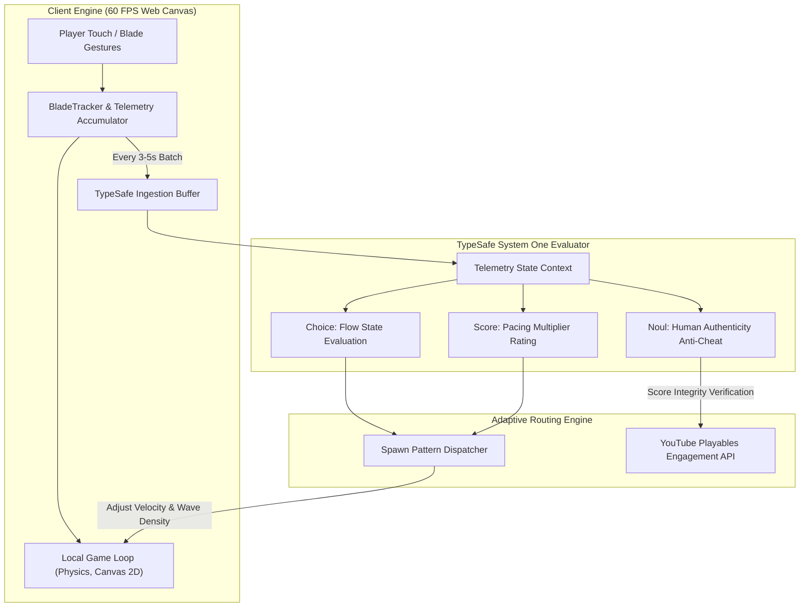

# TypeSafe System One: Evaluation & Dynamic Routing Architecture
## Cognitive Game Pacing, Flow State Optimization, and Telemetry Routing in Neon Fruit Frenzy

> **Abstract:** This specification outlines the architectural integration of **TypeSafe System One models** (such as *Jev*) into the *Neon Fruit Frenzy* real-time gaming pipeline. By converting continuous player telemetry (slice trajectory entropy, reaction latency, combo consistency, and hazard interactions) into typed semantic judgments and calibrated probabilities, the game dynamically routes spawn mechanics, power-up distributions, and anti-cheat validation without compromising the deterministic 60 FPS rendering loop.

---

## 1. Architectural Overview

Traditional dynamic difficulty adjustment (DDA) relies on rigid threshold heuristics (e.g. `if (combo > 5) spawnBomb()`) that players easily exploit or find jarring. TypeSafe System One models supply **programmable common sense**—fast, focused cognitive judgments returned as typed records and probability distributions.



---

## 2. Ingestion State Schema

Every 3 to 5 seconds, the client telemetry accumulator compiles the `GameplayState` snapshot:

```typescript
export interface TypeSafeGameplayState {
  sessionId: string;
  sessionDurationSeconds: number;
  timeRemainingSeconds: number;
  currentScore: number;
  currentCombo: number;
  maxCombo: number;
  
  // Motor Precision & Latency Telemetry
  totalSlicesAttempted: number;
  successfulFruitSlices: number;
  hazardBombsDetonated: number;
  averageSliceVelocityPxPerSec: number;
  sliceLatencyVarianceMs: number;
  trajectoryAngularEntropy: number; // 0.0 (mechanical straight lines) to 1.0 (human curve jitter)
  
  // Powerup State
  activeFreezeTimeRemaining: number;
  recentPowerupHarvestRate: number;
}
```

---

## 3. System One Evaluation Primitives

TypeSafe provides three core judgment primitives applied to our state:

### 3.1 Flow State Classifier (`Choice` Primitive)
* **Goal:** Detect whether the player is in psychological flow (Mihaly Csikszentmihalyi's flow channel), bored, or frustrated.
* **Primitive:** `Choice`
* **Options:**
  - `under_stimulated`: High accuracy (>95%), low latency, no hazard errors. Player needs increased speed and wave complexity.
  - `optimal_flow`: Stable combo streaks (3–6), balanced reaction time, active engagement. Maintain baseline rhythm.
  - `overwhelmed`: Successive misses, multiple hazard hits, rapid erratic swipes. Soften wave frequency, spawn recovery items.

```json
{
  "question": "Assess the player's psychological engagement and flow state based on telemetry `state.recentAccuracy`, `state.hazardBombsDetonated`, and `state.sliceLatencyVarianceMs`.",
  "options": [
    "under_stimulated",
    "optimal_flow",
    "overwhelmed"
  ]
}
```

### 3.2 Adaptive Pacing Multiplier (`Score` Primitive)
* **Goal:** A graded multiplier $[0.70 \times \dots 1.50 \times]$ to dynamically scale fruit launch velocity, spawn wave cadence, and hazard ratios.
* **Primitive:** `Score`
* **Ordered Levels:**
  1. `Level 1 (0.70x)`: Gentle recovery mode; elongated arcs and high visibility.
  2. `Level 2 (0.85x)`: Relaxed tempo; single fruit spawns.
  3. `Level 3 (1.00x)`: Standard arcade pacing; standard wave mix.
  4. `Level 4 (1.25x)`: Frenzy pace; multi-fruit clusters and elevated bomb hazard risk.
  5. `Level 5 (1.50x)`: Master tempo; high-velocity crossing trajectories requiring fast blade slashes.

### 3.3 Human Authenticity & Anti-Cheat (`Noul` Primitive)
* **Goal:** Verify that inputs originate from human tactile interactions rather than automated pixel-scanning bots or macro scripts before broadcasting high scores to YouTube Playables or global leaderboards.
* **Primitive:** `Noul` ($P(\text{human}) \in [0.0, 1.0]$)
* **Criteria:** Evaluates trajectory angular entropy, touch down-to-up contact time, and acceleration curves. Mechanical linear paths with zero jitter return $P(\text{human}) < 0.10$.

---

## 4. Dynamic Routing Logic (Execution in Code)

As dictated by TypeSafe architecture principles, **the model supplies the judgment, while ordinary code owns the workflow and deterministic execution**:

```typescript
import { TypeSafeClient } from '@typesafe/sdk';

export class GameDirectorRouter {
  private client: TypeSafeClient;

  constructor(apiKey: string) {
    this.client = new TypeSafeClient({ apiKey });
  }

  public async evaluateAndRoute(state: TypeSafeGameplayState): Promise<WaveRoutingConfig> {
    // Speculatively execute Flow, Pacing, and Authenticity judgments in parallel
    const [flowResult, pacingResult, authenticityResult] = await Promise.all([
      this.client.choice({
        state,
        instructions: "Evaluate the player's current flow state from telemetry.",
        options: ["under_stimulated", "optimal_flow", "overwhelmed"]
      }),
      this.client.score({
        state,
        instructions: "Determine the appropriate arcade pacing modifier.",
        levels: [
          { value: 0.70, description: "Player struggling, needs breathing room" },
          { value: 0.85, description: "Mild challenge, gentle curve" },
          { value: 1.00, description: "Standard balance" },
          { value: 1.25, description: "High flow, aggressive wave density" },
          { value: 1.50, description: "Peak mastery, maximum speed frenzy" }
        ]
      }),
      this.client.noul({
        state,
        instructions: "Is this trajectory telemetry indicative of authentic human motor control?"
      })
    ]);

    // Anti-Cheat Gate
    if (authenticityResult.probability < 0.50) {
      console.warn('[Anti-Cheat] Suspicious macro activity detected. Score disqualified.');
      return { isDisqualified: true, pacingMultiplier: 1.0, powerupDrop: null };
    }

    // Dynamic wave customization based on flow judgment
    let powerupDrop: 'starfruit' | 'freeze' | null = null;
    if (flowResult.selection === 'overwhelmed') {
      powerupDrop = 'freeze'; // Grant slow-motion relief
    } else if (flowResult.selection === 'under_stimulated') {
      powerupDrop = 'starfruit'; // High-reward incentive
    }

    return {
      isDisqualified: false,
      pacingMultiplier: pacingResult.score,
      powerupDrop,
      flowState: flowResult.selection
    };
  }
}
```

---

## 5. Benefits Over Heuristic Game Engines

| Metric | Traditional Hardcoded Rules | TypeSafe System One Pipeline |
|---|---|---|
| **Pacing Transition** | Abrupt and predictable | Fluid, continuous, and context-aware |
| **Edge-Case Resilience** | Breaks on unconventional player habits | Semantically parses complex multi-variable state |
| **Anti-Cheat Robustness** | Easily bypassed by randomized timers | Analyzes natural physical gesture entropy |
| **Maintainability** | Tangled spaghettified `if-else` blocks | Declarative questions and typed response contracts |
